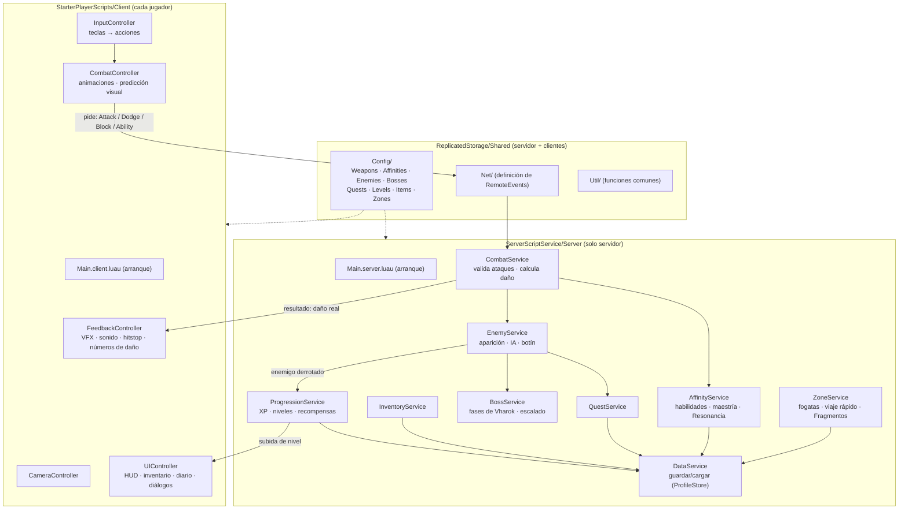
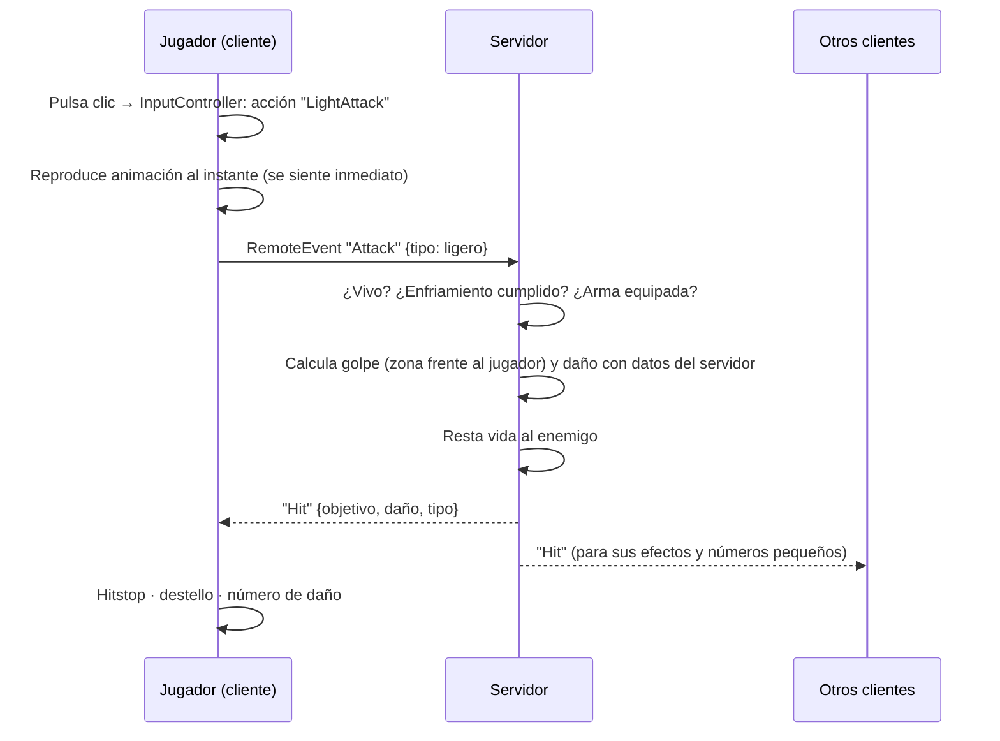

# ECLIPSE: The Fragments of Dawn — Sección 2, Entrega 2A
## Herramientas, flujo de trabajo y arquitectura general

> [SUPUESTO] El prompt base solo detalla la Sección 1. Para la Sección 2 propongo el contenido de abajo; puedes cambiarlo.

### Plan de la Sección 2 — Arquitectura técnica [PROPUESTA]
| Entrega | Contenido | ¿Código? |
|---|---|---|
| **2A** (esta) | Herramientas, flujo de trabajo, conceptos base, arquitectura general y estructura de carpetas | No |
| 2B | Datos y red: esquema de guardado, tablas de configuración, lista de mensajes cliente↔servidor y sus validaciones | No |
| 2C | Plan de producción semana a semana hasta el slice vertical y hasta la v1 | No |
| 2D | Esqueleto del proyecto en GitHub (Rojo) + pasos para conectarlo a Studio y probar que funciona | Sí (mínimo, sin sistemas de juego) |

Propuesta para las demás secciones: **Sección 3** = construir los sistemas (por orden del plan); **Sección 4** = pulido, pruebas, idiomas y publicación.

---

## 1. Herramientas (todas gratuitas)
| Herramienta | Para qué sirve | ¿Imprescindible? |
|---|---|---|
| **Roblox Studio** | Construir el mapa, probar el juego, publicar | Sí |
| **Git + GitHub** (con **GitHub Desktop** si prefieres botones a comandos) | Guardar el historial del código y volver atrás si algo se rompe | Sí |
| **VS Code** | Editor de código en tu PC (donde también puedes usar Codex) | Sí |
| **Rojo** (programa + plugin de Studio) | Sincroniza los archivos del repositorio con Studio en tiempo real | Sí (decisión aprobada) |
| **Rokit** | Instala y fija la versión de Rojo y demás herramientas con un solo comando | Recomendado [VERIFICAR EN DOCUMENTACIÓN: github.com/rojo-rbx/rokit] |
| **Luau LSP** (extensión de VS Code) | Autocompletado y detección de errores de Luau en VS Code | Muy recomendado |
| **Selene** (linter = revisor automático) | Detecta errores comunes y APIs mal usadas — muy útil para revisar código de IA | Recomendado |
| **StyLua** (formateador) | Deja todo el código con el mismo estilo automáticamente | Opcional |

Justificación: Luau LSP + Selene son tu "red de seguridad" contra el código generado por IA (riesgo alto de la Entrega 1A).

---

## 2. Flujo de trabajo diario
```
 ┌──────────────┐   edita    ┌──────────────┐  rojo serve  ┌──────────────────┐
 │ Codex / IA   │──────────▶ │ VS Code      │────────────▶ │ Roblox Studio    │
 │ (propone)    │            │ (tú revisas) │  (en vivo)   │ (pruebas: Play)  │
 └──────────────┘            └──────┬───────┘              └────────┬─────────┘
                                    │ commit + push                 │ el mapa se
                                    ▼                               ▼ guarda aquí
                             ┌──────────────┐              ┌──────────────────┐
                             │ GitHub       │              │ Roblox (Publish) │
                             │ (código)     │              │ (mapa y modelos) │
                             └──────────────┘              └──────────────────┘
```
Reglas:
1. **El código vive en GitHub**, nunca solo en Studio. Si editas un script dentro de Studio, Rojo lo sobrescribirá.
2. **El mapa vive en Studio** y se guarda publicándolo en Roblox (Studio: **File → Publish to Roblox**), que guarda historial de versiones. [VERIFICAR EN DOCUMENTACIÓN: "place version history"]
3. Interfaces (UI) diseñadas visualmente en Studio se exportan como archivo `.rbxmx` al repositorio, para que también tengan historial.
4. Un **commit pequeño por cada cosa que funcione** ("feat: esquiva básica"), nunca días de trabajo en un solo commit.
5. Todo código de IA: lo lees, lo pruebas en Studio, y solo entonces haces commit.

---

## 3. Conceptos base de Roblox (primera vez que aparecen)
| Concepto | Qué es | Dónde se ve en Studio |
|---|---|---|
| **Servidor** | El ordenador de Roblox que ejecuta la partida; la única fuente de verdad | — |
| **Cliente** | El dispositivo de cada jugador; dibuja, recibe teclas, reproduce efectos | — |
| **Script** | Código que corre en el **servidor** | Ventana **Explorer** (View → Explorer) |
| **LocalScript** | Código que corre en el **cliente** de un jugador | Explorer |
| **ModuleScript** | Código reutilizable que otros scripts cargan con `require` | Explorer |
| **ReplicatedStorage** | Carpeta visible para servidor y clientes (código compartido, configuración) | Explorer |
| **ServerScriptService / ServerStorage** | Carpetas que solo ve el servidor (lógica secreta, enemigos de plantilla) | Explorer |
| **StarterPlayerScripts** | Lo que se copia al cliente de cada jugador al entrar | Explorer → StarterPlayer |
| **RemoteEvent** | "Mensajero" entre cliente y servidor. El cliente **pide**, el servidor **decide** | Explorer |
| **Replicación** | Roblox copia automáticamente cambios del servidor a los clientes (p. ej., posiciones) | — |

Regla de oro (server-authoritative, aprobada): **todo lo que el cliente envía es una petición sospechosa** hasta que el servidor la valida.

---

## 4. Arquitectura general

### 4.1 Patrón: "servicios" (servidor) y "controladores" (cliente) [PROPUESTA]
- Cada sistema es un **ModuleScript** con dos funciones: `Init()` (prepararse) y `Start()` (empezar a funcionar).
- Un único script de arranque en el servidor y otro en el cliente cargan todos los módulos en orden.
- **Sin frameworks externos** (como Knit): menos cosas que aprender y que se puedan quedar sin mantenimiento. El patrón cabe en ~30 líneas que entenderás por completo.
- **Datos separados de la lógica**: armas, enemigos, misiones, niveles… viven en tablas de configuración. Añadir contenido = añadir filas.

### 4.2 Diagrama


### 4.3 Ejemplo de flujo: un ataque ligero

El cliente **nunca** envía "hice 50 de daño a este enemigo"; solo "quiero atacar". [PENDIENTE: detalle de validaciones en 2B]

### 4.4 Cómo se añaden regiones futuras sin rehacer nada
- Cada región = **una carpeta de configuración** (`Config/Zones/Verdantia`) + su parte del mapa.
- Los servicios leen "qué hay en esta zona" de la configuración; no tienen nombres de Verdantia escritos en el código.
- [PROPUESTA] Si en el futuro el mapa crece demasiado, cada región puede ser un **lugar separado** del mismo juego, conectados por teletransporte. [VERIFICAR EN DOCUMENTACIÓN: "TeleportService", "places in an experience"]. En la v1 todo es un solo lugar.

---

## 5. Estructura de carpetas del repositorio [PROPUESTA]
```
ROBLOX-JUEGO-1/
├─ default.project.json        ← le dice a Rojo dónde va cada carpeta en Studio
├─ rokit.toml                  ← versiones de Rojo, Selene, StyLua
├─ selene.toml / stylua.toml   ← reglas del revisor y del formateador
├─ docs/                       ← GDD, decisiones, arquitectura (esto)
└─ src/
   ├─ server/                  → ServerScriptService/Server
   │  ├─ Main.server.luau
   │  └─ Services/             (DataService.luau, CombatService.luau, …)
   ├─ client/                  → StarterPlayer/StarterPlayerScripts/Client
   │  ├─ Main.client.luau
   │  └─ Controllers/          (InputController.luau, …)
   ├─ shared/                  → ReplicatedStorage/Shared
   │  ├─ Config/               (Weapons.luau, Enemies.luau, Quests.luau, …)
   │  ├─ Net/
   │  └─ Util/
   ├─ ui/                      → interfaces exportadas desde Studio (.rbxmx)
   └─ localization/            → textos ES/EN
```
Nombres de archivos y código en inglés (regla del prompt). El mapa (Workspace) **no** lo gestiona Rojo.

---

## 6. Decisiones de esta entrega que necesitan tu aprobación
| # | Propuesta | Alternativa | Recomendación |
|---|---|---|---|
| A1 | Plan de la Sección 2 en 4 entregas (2A–2D) y Secciones 3–4 como arriba | Otro orden | Aprobar |
| A2 | Herramientas: Rokit, Luau LSP y Selene además de Rojo; StyLua opcional | Solo Rojo | Aprobar (son la red de seguridad para el código de IA) |
| A3 | Patrón servicios/controladores **sin framework externo** | Usar Knit u otro framework | Sin framework |
| A4 | Guardado con **ProfileStore** (módulo gratuito y open source) [VERIFICAR: que siga mantenido al instalarlo] | DataStoreService "a mano" | ProfileStore (protege contra pérdida y duplicación de datos) |
| A5 | Código en GitHub vía Rojo; mapa en Studio publicado en Roblox; UI exportada `.rbxmx` | Todo dentro de Studio | Aprobar |
| A6 | Estructura de carpetas de la sección 5 | — | Aprobar |
